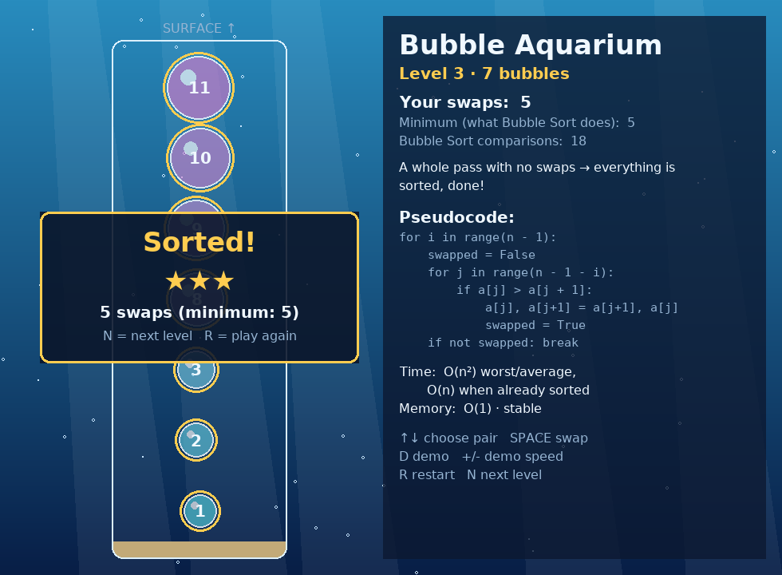

# 1. Bubble Sort: *Bubble Aquarium* 🫧

A small Pygame game. The aquarium holds a column of numbered bubbles, and
bigger bubbles want to float up to the surface. Like Bubble Sort, you may only
swap **two neighbouring** bubbles. Sort them using as few swaps as possible.


## How to run

```bash
pip install pygame        # or: sudo apt install python3-pygame
python bubble_aquarium.py
```

## Controls

| Key | Action |
|-----|--------|
| ↑ / ↓ | choose a pair of neighbours |
| SPACE | swap the pair |
| D | demo: the algorithm sorts the same bubbles step by step |
| + / - | demo speed |
| R | restart the level |
| N | next level (one more bubble) |
| ESC | quit |

## What it teaches

- **Neighbour swaps only.** This is the core idea of Bubble Sort.
- **Passes.** After each pass the largest remaining bubble reaches its final
  place (gold ring), so every pass can stop one element earlier.
- **Early exit.** A whole pass without a swap means the list is already sorted.
- **Optimal swap count.** Bubble Sort makes exactly as many swaps as there are
  out-of-order pairs (inversions). That is the minimum number of neighbour
  swaps, so you get 3 stars only if you match it.
- **Live pseudocode.** In demo mode the line being executed is highlighted.
  Colours: yellow = comparing, red = swapping, green = already in order.

## Complexity

| Best | Average | Worst | Memory | Stable |
|------|---------|-------|--------|--------|
| O(n) | O(n²) | O(n²) | O(1) | yes |

## Screenshots

| Playing | Solved |
|---------|--------|
|  |  |
