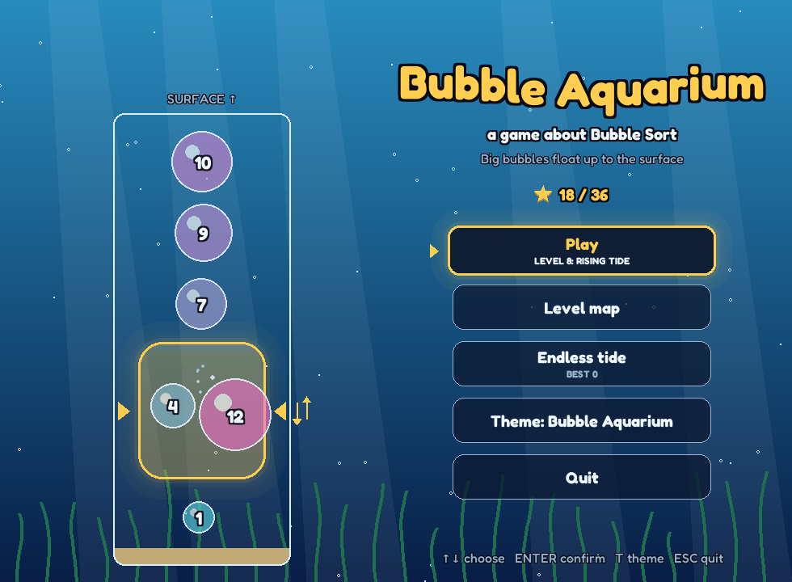
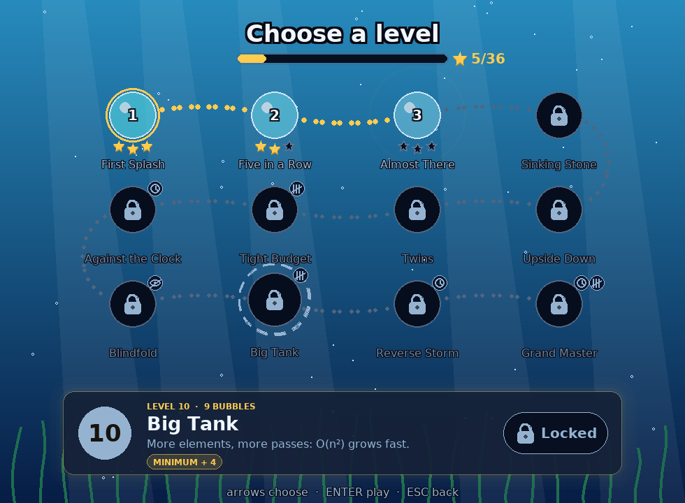

# 1. Bubble Sort: *Bubble Sort Quest* 🫧🌧️🔥

A small Pygame game. A tank holds numbered elements, and you may only swap
**two neighbours**, exactly like Bubble Sort does. The element on top
**surfaces** (leaves the tank and scores) only when it is the **biggest one in
the tank**, just like the largest element reaches its final place at the end
of a Bubble Sort pass. New elements keep arriving from below; if one arrives
while the tank is full, the tank overflows and you lose.



## How to run

```bash
pip install pygame        # or: sudo apt install python3-pygame
python baq.py
python baq.py --fullscreen   # or start in fullscreen
```

**Fullscreen**: press **F11** (or Alt+Enter) anywhere, or use *Fullscreen* in
the main menu. The game is drawn at 980×720 and scaled to the screen with its
proportions kept (black bars on the sides of a 16:9 laptop screen). The window
can also be resized. The choice is remembered.

Progress (stars, best scores, Endless high score, chosen theme) is stored in
`save.json` next to the game. Delete it to start over.

## The goal and why it is Bubble Sort

Fixing out-of-order pairs at random does not work here: nothing surfaces
until the biggest element is on top. The winning habit is to **carry the
biggest element up, pair by pair**, which is one Bubble Sort pass. The
game turns the ideas of the algorithm into rules:

| Bubble Sort idea | Game rule |
|------------------|-----------|
| only neighbours are compared and swapped | you can only swap a neighbouring pair |
| after a pass the largest element is in its final place | the top element surfaces once it is the biggest |
| the sorted part at the top grows every pass | **chains**: if the top of the column is already sorted, it surfaces in one go, ×2, ×3, ... (gold rings show what would chain) |
| swap only if `a[j] > a[j + 1]` | a swap that breaks the order is a **wrong swap** (red flash on line 4 of the pseudocode) |
| equal values are never swapped (stability) | swapping equal values is also a wrong swap |
| inversions = swaps needed | the **inversions** tile counts the pairs still out of order; every good swap removes exactly one |
| best case / worst case | levels with nearly sorted data, reversed data, and arrivals that each must cross the whole tank |

Points: a surfacing element is worth `10 × value × chain`. Letting the next
element in early (**F** or a click on the NEXT box) gives a small bonus, at
the risk of a fuller tank.

Every level has **three stars**, each tied to one idea:
**cleared** (surface the level's number of elements),
**chain ×N** (sort the top before the biggest arrives there) and
**clean** (no wrong swaps).

## Levels

Levels sit on a winding map; a level unlocks once the previous one is solved.
Badges on the nodes show arrivals (clock), "no wrong swaps" (tally) and
hidden numbers (eye).

| # | Level | Tank | Rule | What it teaches |
|---|-------|------|------|-----------------|
| 1 | First Splash | 4 | no arrivals | the biggest on top surfaces |
| 2 | Sinking Stone | 6 | no arrivals | one pass carries the largest up, the rest chains |
| 3 | Almost There | 7 | no arrivals | best case: few swaps, one long chain |
| 4 | Upside Down | 6 | no arrivals | worst case: n(n-1)/2 swaps |
| 5 | First Drops | 8 | arrival every 7 s | keep the tank from overflowing |
| 6 | Twins | 8 | arrivals, duplicates | stability: equals are never swapped (labels a, b, c) |
| 7 | Clean Hands | 8 | one wrong swap = lost | swap only if the lower one is bigger |
| 8 | Rising Tide | 8 | arrivals speed up | keep carrying the biggest one up |
| 9 | Blindfold | 8 | hidden numbers | compare by size only |
| 10 | Pressure | 7 | fast arrivals | sort the top for big chains |
| 11 | Reverse Storm | 9 | every newcomer is bigger | each must cross the whole tank |
| 12 | Grand Master | 9 | fast, strict, 20 to surface | everything together |

After level 4, **Endless tide** unlocks in the main menu: arrivals keep getting
faster until the tank overflows. Your high score is saved.



## Themes and fonts

Each theme has its own look **and its own typefaces**:

| Theme | Elements | Fonts |
|-------|----------|-------|
| 🫧 **Bubble Aquarium** | bubbles | Fredoka: round and soft, like bubbles |
| 🌧️ **Rain Garden** | raindrops on a vine | Caveat Brush (a hand-painted garden sign) + Nunito |
| 🔥 **Fire Pit** | fireballs in a stone chimney | Bungee (bold signage) + Barlow Semi Condensed |

The pseudocode uses JetBrains Mono in every theme. All fonts are from Google
Fonts under the SIL Open Font License (`fonts/OFL.txt`). Characters a font
does not have (arrows) fall back to DejaVu Sans.

Pick a theme in *Theme* in the main menu, or press **T** at any time.


## Controls

| Key | Action |
|-----|--------|
| ↑ / ↓, mouse wheel | choose a pair of neighbours |
| click a pair | select it; click the selected pair again to swap |
| SPACE | swap the pair |
| F, click NEXT | let the next element in now (bonus) |
| D | demo: Bubble Sort sorts the tank step by step, then it all surfaces in one chain |
| SPACE / → (in demo) | pause / one step |
| + / - | demo speed |
| R | restart the level (same arrivals) |
| N | next level (after solving this one) |
| T | change theme |
| F11, Alt+Enter | fullscreen on / off |
| ESC | back (level → map → menu → quit) |

## Animations

- **Screen changes** cross-fade with a slight zoom; nothing goes to black.
- **Theme changes** open the new theme in a growing circle with a glowing edge,
  starting from the card you picked (or the tank, in a level).
- **Entrances**: the menu title drops in and its letters keep waving, menu
  buttons slide in one by one, the level-map path draws itself dot by dot and
  the nodes pop in along it, the level card slides up, theme cards rise, and the
  side panel and its tiles slide in when a level starts.
- **Play**: swapped elements pass each other on curved paths; the element about
  to surface glows, rises to the surface line and pops with a shock wave and a
  floating score; chains show a springy *CHAIN ×N* banner; newcomers rise in
  from below; the NEXT box has a timer ring and the next element jitters right
  before it drops in; the tank pulses red when it is full; the slot lights on
  the tank's side show how full it is; the score counts up.
- Your own swaps light up their pseudocode line (green: line 5, swap; red:
  line 4, the comparison you ignored).

## Screenshots

| Playing (Fire Pit) | Demo (Rain Garden) | Cleared |
|---------|------|--------|
|  |  |  |

## Code layout

| File | Contents |
|------|----------|
| `baq.py` | game: rules (surfacing, chains, arrivals), menus, transitions, drawing |
| `levels.py` | the 12 levels, Endless, starting data and arriving values |
| `themes.py` | the three visual themes (background, particles, elements) |
| `fonts.py` | per-theme fonts with a fallback for missing characters |
| `fonts/` | the .ttf files and their licence |

## Complexity

| Best | Average | Worst | Memory | Stable |
|------|---------|-------|--------|--------|
| O(n) | O(n²) | O(n²) | O(1) | yes |
