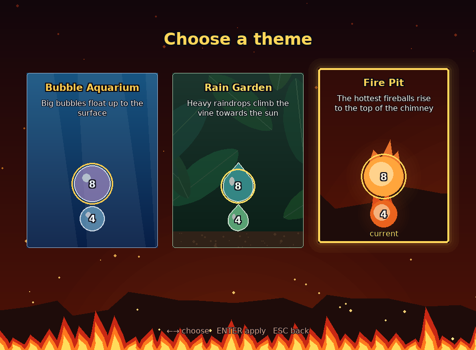
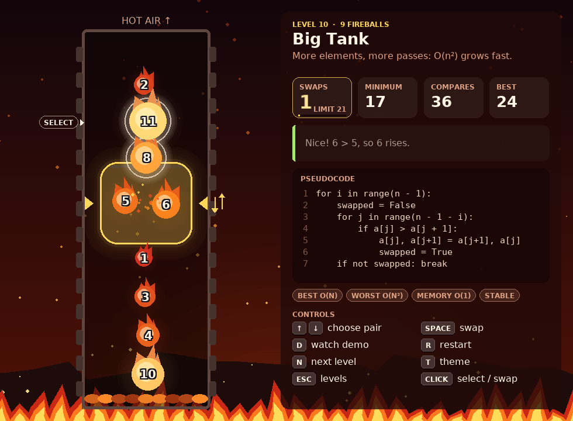
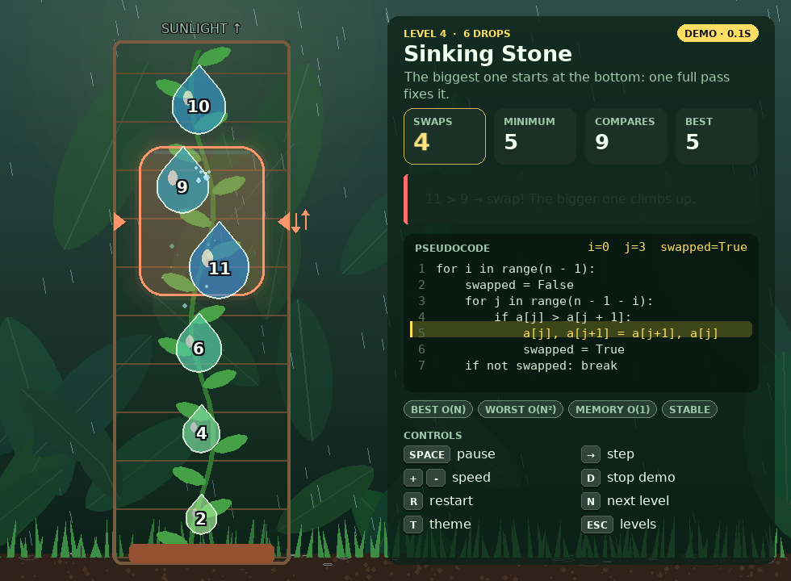

# 1. Bubble Sort: *Bubble Sort Quest* 🫧🌧️🔥

A small Pygame game. A column holds numbered elements, and bigger elements
want to rise to the top. Like Bubble Sort, you may only swap **two
neighbouring** elements. Sort them using as few swaps as possible.


## How to run

```bash
pip install pygame        # or: sudo apt install python3-pygame
python baq.py
```

Progress (stars, best scores, chosen theme) is stored in `save.json` next to
the game. Delete it to start over.

## Themes

| Theme | Elements | Idea |
|-------|----------|------|
| 🫧 **Bubble Aquarium** | bubbles | big bubbles float up to the surface |
| 🌧️ **Rain Garden** | raindrops on a vine, rain and puddle ripples | heavy drops climb the vine towards the sun |
| 🔥 **Fire Pit** | fireballs in a stone chimney, flames and embers | the hottest fireballs rise to the top |

Pick one in *Theme* in the main menu, or press **T** at any time.



## Levels

Each level teaches one idea. Levels sit on a winding map: the path lights up
as you go, the next level pulses, small badges show its rules (clock, swap
limit, hidden numbers), and the card at the bottom shows the details and a
**PLAY** button. A level unlocks once the previous one is solved.

| # | Level | Elements | What it teaches / rule |
|---|-------|----------|------------------------|
| 1 | First Splash | 4 | the basics |
| 2 | Five in a Row | 5 | each pass carries the largest element to the top |
| 3 | Almost There | 6 | best case: nearly sorted data |
| 4 | Sinking Stone | 6 | biggest at the bottom: one pass + early exit |
| 5 | Upside Down | 6 | worst case: n(n-1)/2 swaps |
| 6 | Twins | 7 | duplicates: Bubble Sort is **stable** (labels a, b, c) |
| 7 | Tight Budget | 7 | swap limit = exactly the minimum |
| 8 | Against the Clock | 7 | 40 s time limit |
| 9 | Blindfold | 6 | numbers hidden, compare by size |
| 10 | Big Tank | 9 | swap limit = minimum + 4 |
| 11 | Reverse Storm | 9 | worst case, 75 s |
| 12 | Grand Master | 10 | minimum swaps **and** 120 s |


## Controls

| Key | Action |
|-----|--------|
| ↑ / ↓, mouse wheel | choose a pair of neighbours |
| mouse over a pair | its two elements glow, with a "SELECT" tag |
| click a pair | select it; click the selected pair again to swap |
| SPACE | swap the pair |
| D | demo: the algorithm sorts the same data step by step |
| SPACE / → (in demo) | pause / one step |
| + / - | demo speed |
| R | restart the level |
| N | next level (after solving this one) |
| T | change theme |
| ESC | back (level list → menu → quit) |

## Animations and polish

- Swapped elements pass each other on curved paths (eased motion) instead of
  jumping.
- The selected pair is a glowing, breathing capsule with arrows pointing at it;
  it glides between pairs and changes colour in the demo
  (gold = compare, red = swap, green = keep).
- The pair under the mouse gets glowing halos around its two elements (never a
  second box, so it does not cover the gold one), and they grow a little.
- The side panel is made of cards: stat tiles (swaps with a budget bar, minimum,
  comparisons, time or best), a message card coloured by what happened, a
  pseudocode card with line numbers and live `i`, `j`, `swapped`, complexity
  chips and the controls drawn as keyboard keys.
- Elements rise into place when a level starts, bounce in a wave when it is
  solved, and pop when they reach their final place.
- The result card springs in and the stars appear one by one.
- Buttons and level cards lift and glow on hover, locked levels wiggle "no",
  screens fade between each other, the cursor turns into a hand over
  anything clickable.

## What it teaches

- **Neighbour swaps only.** This is the core idea of Bubble Sort.
- **Passes.** After each pass the largest remaining element reaches its final
  place (gold ring), so every pass can stop one element earlier.
- **Early exit.** A whole pass without a swap means the list is already sorted.
- **Best and worst case.** Nearly sorted vs. reversed levels show O(n) vs. O(n²).
- **Stability.** Equal values are never swapped, so their order (a, b, c) stays.
- **Optimal swap count.** Bubble Sort makes exactly as many swaps as there are
  out-of-order pairs (inversions). That is the minimum number of neighbour
  swaps, so you get 3 stars only if you match it.
- **Live pseudocode.** In demo mode the executed line is highlighted and the
  values of `i`, `j` and `swapped` are shown.
  Colours: gold = comparing, red = swapping, green = already in order.

## Code layout

| File | Contents |
|------|----------|
| `baq.py` | game: menus, level logic, demo, drawing the panel |
| `levels.py` | the 12 levels and how their starting data is generated |
| `themes.py` | the three visual themes (background, particles, elements) |

## Complexity

| Best | Average | Worst | Memory | Stable |
|------|---------|-------|--------|--------|
| O(n) | O(n²) | O(n²) | O(1) | yes |

## Screenshots

| Playing (Fire Pit) | Demo (Rain Garden) | Solved |
|---------|------|--------|
|  |  |  |
